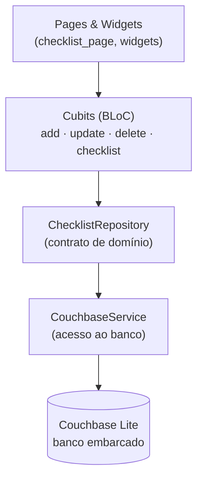

# Checklist local-first — Flutter + Couchbase Lite

[](https://github.com/brenoluizdev/flutter-offline-checklist/actions/workflows/ci.yml)
[](https://flutter.dev)


Aplicativo de lista de compras que funciona **sem rede**: os dados vivem no
dispositivo, em um banco embarcado, e a interface responde na hora.

---

## O problema

A maioria dos apps de lista assume que existe uma API disponível. No supermercado
— exatamente onde a lista é usada — o sinal costuma falhar. O resultado é tela de
erro, item que não salva e lista duplicada quando a conexão volta.

A proposta aqui é o caminho inverso: **o banco local é a fonte da verdade** e a
sincronização com um servidor é um passo posterior, não um pré-requisito para usar.

## O que o app faz

- Adiciona itens à lista, com data de criação.
- Marca e desmarca itens como concluídos.
- Edita o título de um item.
- Remove itens.
- Tudo persistido localmente e disponível na próxima abertura, sem rede.

## Arquitetura



- **Um Cubit por operação** (`add`, `update`, `delete`, `checklist`), cada um com seu
  estado imutável. A UI reage a estado, não a `setState`.
- **Repository** isola o domínio do banco: a entidade `ShoppingItemEntity` não
  conhece Couchbase.
- **CouchbaseService** concentra as queries N1QL e o mapeamento de documentos,
  incluindo o `id` retornado por `META()`.

## Stack

| Item | Tecnologia |
| --- | --- |
| Framework | Flutter 3.5 / Dart 3.5 |
| Estado | `flutter_bloc` (Cubit) + `provider` |
| Banco local | Couchbase Lite (`cbl`, `cbl_flutter`, `cbl_flutter_ce`) |
| UI | Material 3, Google Fonts, `intl` |

## Rodando

```bash
flutter pub get
flutter run          # Android, iOS ou emulador
```

Requer Flutter 3.5+ e um dispositivo/emulador configurado.

## O que este projeto demonstra

- Modelagem de dados local-first com banco embarcado, em vez de cache de API.
- Separação em camadas (UI → Cubit → Repository → Service → banco).
- Estado previsível: cada operação tem seu próprio Cubit e estado tipado.

## Testes

```bash
flutter test
```

O CI roda `flutter analyze` e `flutter test` em todo push e pull request.
Os testes atuais cobrem a entidade e o mapeamento de/para o documento persistido.

## Próximos passos

- [ ] Replicação com Couchbase Sync Gateway (o motivo de usar CBL em vez de
      `sqflite`/`hive`).
- [ ] Testes de unidade nos Cubits e no repositório.
- [ ] Resolução de conflito documentada.

> Projeto de estudo técnico de arquitetura local-first, não um produto em produção.

---

Feito por [Breno Luiz](https://github.com/brenoluizdev)
